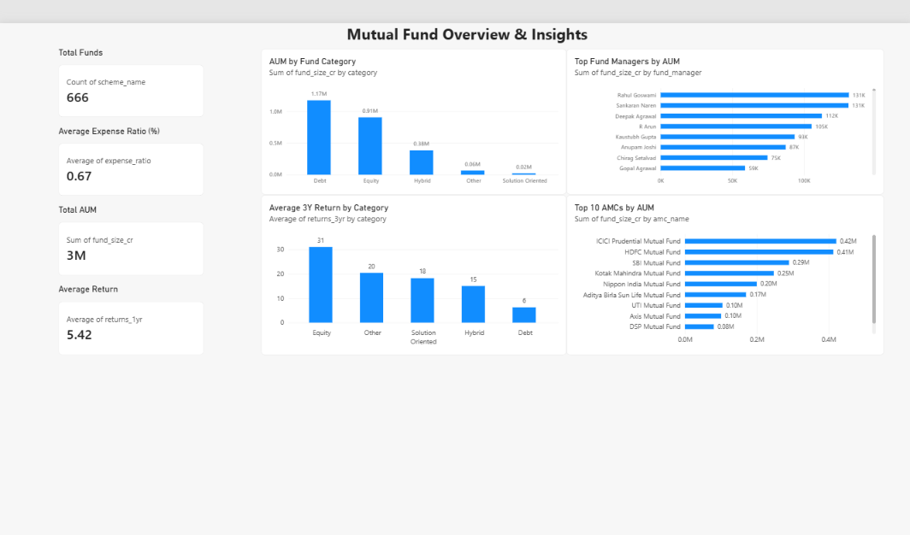

# Mutual Fund Overview & Insights: Finding High-Return, Low-Cost Funds

## Business Problem
There are hundreds of mutual funds, and investors struggle to tell which ones offer good returns, lower fees and manageable risk. This project ranks funds using a transparent scoring model.

## Dataset
- 814 mutual fund schemes, 20 columns (39 AMCs, 5 categories)
- Fields include expense ratio, fund size (AUM), fund age, risk level, rating, and 1/3/5-year returns
- Dataset provided as part of the Coding Ninjas project

## Tools Used
Python (Pandas, NumPy, Matplotlib, Seaborn, Scikit-learn), Excel, Power BI

## Approach
1. **Data cleaning:** converted `alpha`, `beta`, `sharpe`, `sortino` and `sd` from text to numeric (the "-" placeholder became NaN, not zero); investigated 25 duplicate scheme names (different records, so none removed); checked outliers with box plots and IQR (87 outliers in 1-year returns, retained as genuine values)
2. **Filtering for scoring:** excluded funds with negative 1-year returns or missing 3-year returns, leaving 666 funds (no imputation)
3. **EDA:** distributions of returns, expense ratio, fund size, fund age and risk level
4. **Normalization:** MinMaxScaler (0 to 1 scale)
5. **Fund Score:** weighted score for each fund

| Component | Weight |
|---|---|
| 3-year return | 35% |
| Expense ratio (lower is better) | 25% |
| Fund age | 15% |
| 1-year return | 10% |
| Risk level (lower is better) | 15% |

6. **Ranking:** ranked 666 funds and exported the Top 30 to Excel
7. **Dashboard:** interactive Power BI report with KPI cards, charts and slicers (AMC, category, risk level, rating)

## Key Findings
- Top-ranked fund: Quant Small Cap Fund (score 0.663, 3-year return 71.4%)
- The Top 30 spans four categories: Equity 12, Debt 8, Hybrid 7, Other 3
- Quant Mutual Fund has 7 of the Top 30; HSBC, ICICI Prudential and HDFC have 3 each
- Risk is mixed: 13 funds at risk level 6 and 10 at risk level 1
- Across all 814 funds: ICICI Prudential manages the largest AUM, Equity has the highest average 3-year return (about 29.7%), and Debt has the lowest average expense ratio (about 0.36%)
- Outliers such as a 130.8% 1-year return (Bank of India Credit Risk Fund, with very high volatility) were investigated and retained

## Dashboard Preview

## Files
- `mutual_fund_analysis.ipynb` : cleaning, EDA, scoring and ranking
- `comprehensive_mutual_funds_data.csv` : raw dataset
- `Top_30_Mutual_Funds.xlsx` : Top 30 ranked funds
- `mutual_fund_analysis_db.pbix` : Power BI report

## Limitations
The Fund Score uses historical returns and the weights are a judgment call. This is not investment advice.
